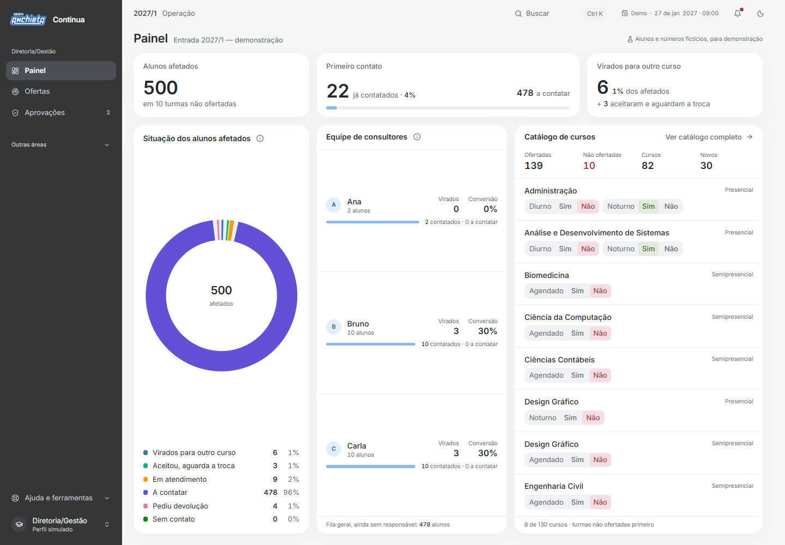

# Anchieta Continua

**Inteligência para antecipar riscos de formação e ajudar cada aluno a continuar sua graduação.**

Planejamento e front-end local do Hackathon Corporativo Grupo Anchieta. Nome de trabalho: **Continua**. Repositório `victorpansonato-design/nao-formacao`. Base de pesquisa: 10/11/2026. A demonstração usa somente dados sintéticos e comandos locais; não há modelo treinado, integração real ou resultado de piloto.

## Executar a demonstração

```powershell
npm ci
npm run dev -- --port 5180
```

Abra o endereço informado pelo Vite (no Windows, rode a partir de `C:\...` com letra maiúscula; a porta 5173 está ocupada nesta máquina). O sistema abre no cenário **Em andamento**, como Diretoria/Gestão, no **Painel**: afetados, contatados, virados, situação, equipe e catálogo com Ofertado Sim/Não. Em **Controle da demo** há também Antecipação (500 matrículas monitoradas, zero afetados), Operação, Pós-início e Encerrada; a troca pede confirmação e substitui só a base sintética do navegador. Em **Ver como**, escolha o perfil simulado.

| Perfil | Primeira tela |
|---|---|
| Diretoria/Gestão | Painel (`/visao-geral`) |
| Consultor | Atendimentos (`/atendimentos`) |
| Suporte | Ajustes acadêmicos (`/ajustes`) |
| Admin técnico | Configurações (`/configuracoes`) |

Verificações: `npm run typecheck`, `npm run lint`, `npm test`, `npm run build` e `npm run test:e2e`. Os testes de navegador usam o Chrome instalado e um Vite local na porta 5182. Resultados observados e capturas reais em [implementation/evidence/README.md](implementation/evidence/README.md).



[Tema escuro](implementation/evidence/cores-referencia/operacao-dark.png) · [Atendimento](implementation/evidence/cores-referencia/atendimento-dark.png) · [Mobile](implementation/evidence/cores-referencia/atendimento-mobile.png). Capturas reais; [cores e verificações](implementation/evidence/cores-referencia/README.md) · [decisões de simplificação](implementation/evidence/simplificacao/README.md).

## Comece aqui

1. Leia [o checkpoint](implementation/status.md) e [as decisões de 12/11/2026](docs/00-decisoes.md); depois [a síntese executiva](docs/01-estrategia.md).
2. Abra [a direção visual](design/direcao-visual.md) e os desenhos em `design/assets/`.
3. No Claude Code ou Codex, com este repositório aberto, use [prompt.md](prompt.md).
4. Construa pelas entregas de [implementação](implementation/roteiro.md).
5. Execute [o piloto](hackathon/piloto.md) e registre resultados reais antes da banca de **27/11/2026, às 14h30**.

## O produto em uma frase

Um centro de operação em que a Diretoria/Gestão marca cada turma como ofertada ou não, os alunos das turmas não ofertadas vão direto à fila dos consultores e cada atendimento vira uma negociação assistida, com alternativas ofertadas e acompanhamento até a troca confirmada no Lyceum ou o pedido de devolução encaminhado.

## Mapa da documentação

| Arquivo | Responde |
|---|---|
| `AGENTS.md` | Quais regras nenhuma mudança pode quebrar? |
| `implementation/status.md` | Onde paramos, o que foi verificado e o que falta? |
| `docs/00-decisoes.md` | O que foi decidido, por quem e o que substituiu (inclui a revisão de 12/11/2026) |
| `docs/01-estrategia.md` | Proposta, escopo e diferenciais para a banca |
| `docs/02-processo.md` | Como um aluno anda do cadastro Não ofertado até a troca ou a saída? |
| `docs/03-previsao.md` | Como a projeção de matrículas é calculada e por que não decide nada |
| `docs/04-financeiro.md` | Cenários de receita, desconto e o registro de devoluções |
| `docs/05-recomendacoes.md` | Quais turmas podem ser oferecidas a um aluno e por quê |
| `docs/06-copiloto.md` | O que o copiloto simulado sugere e seus limites |
| `docs/07-comunicacao.md` | Réguas de mensagem antes e depois do Não ofertado |
| `docs/08-acessos-fila.md` | Quem pode fazer o quê; fila e posse |
| `docs/09-telas.md` | Rotas, telas e o efeito de cada botão |
| `docs/10-dados.md` | Entidades, campos, importação e governança |
| `docs/11-arquitetura.md` | Stack, pastas, comandos, persistência e cenários |
| `docs/12-qualidade.md` | Casos de teste e percursos ponta a ponta |
| `docs/13-indicadores.md` | Definição de cada número, inclusive os do painel |
| `docs/14-riscos-e-producao.md` | Riscos e o que falta para produção |
| `docs/15-catalogo-real.md` | O que no catálogo é real, de onde veio e como atualizar |
| `docs/16-painel-diretoria-gestao.md` | Blocos, métricas, layout e animação do painel |
| `PRODUCT.md`, `DESIGN.md` | Usuários, princípios e direção visual vigente |
| `design/` | Tokens, composição, referências e motion (`design/motion.md` é regra) |
| `research/` | Fontes comentadas, evidências e ferramentas avaliadas |
| `data/` | Base sintética repetível |
| `hackathon/` | Piloto, roteiro da banca e calendário |
| `implementation/` | Ordem de construção, checkpoint e evidências |

## Regras que não podem desaparecer na implementação

- Unidade de cadastro é a **turma**: curso + modalidade + turno. A Diretoria/Gestão marca Ofertado Sim ou Não; não há análise nem aprovação de formação no sistema.
- Projeção não confirma turma. Só turma ofertada pode ser destino.
- Interesse declarado pelo aluno e restrições atuais têm prioridade sobre afinidade genérica.
- Apenas destinos confirmados, com vaga e condições válidas podem receber uma proposta.
- Pedido explícito de devolução segue diretamente; negociação é facultativa. A devolução em si ocorre em outro sistema.
- Toda concessão tem política, validade, escopo e responsável; a IA não inventa descontos.
- Aceite comercial, troca confirmada no Lyceum ("virado") e continuidade após o início das aulas são marcos diferentes.
- O front-end demonstra papéis, filas e conflitos; não oferece segurança real nem concorrência distribuída.
- Não inserir dados pessoais reais no repositório público ou em `localStorage`. O catálogo público de cursos é a única informação real.
- Resultados sintéticos nunca serão apresentados como resultado do piloto.

## Fontes e material recebido

Foram lidos os dois PDFs, inspecionado o HTML e conferida a marca enviada. O relato de Victor é a fonte prioritária para escopo e comportamento. O PDF de levantamento orienta o processo existente. O HTML orienta apenas a leitura das etapas; seu visual e sua base de alunos não serão reutilizados. Os anexos originais não são republicados aqui. Bibliografia verificável em [research/fontes.md](research/fontes.md).

## Estado da entrega

Planejamento, direção visual, domínio e telas da demonstração local implementados. O que depende de validação institucional está identificado. Rodar `python scripts/validate_planning.py` para conferir links locais, base e cálculos do planejamento. Esse verificador é complementar aos testes do aplicativo; consulte o checkpoint em `implementation/status.md`.
