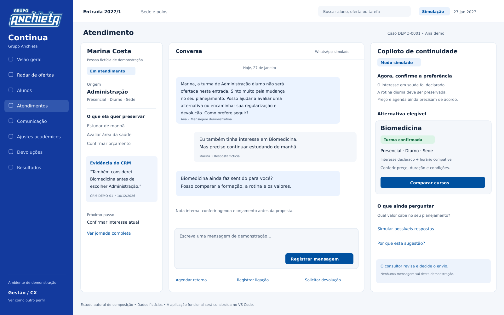

# Anchieta Continua

**Inteligência para antecipar riscos de formação e ajudar cada aluno a continuar sua graduação.**

Planejamento do Hackathon Corporativo Grupo Anchieta. Nome de trabalho: **Continua**. Repositório `victorpansonato-design/nao-formacao`. Base de pesquisa: 10/11/2026. Entrega desta etapa: especificação para construir um front-end funcional no VS Code; não há aplicação pronta, modelo treinado ou integração real neste commit.

[Radar claro](design/assets/radar-claro.png) · [Radar escuro](design/assets/radar-escuro.png) · [Atendimento escuro](design/assets/atendimento-escuro.png). Estudos autorais de direção visual; não são telas de aplicação implementada.

## Comece aqui

1. Leia [a síntese executiva](docs/01-estrategia.md).
2. Abra [a direção visual](design/direcao-visual.md) e os desenhos em `design/assets/`.
3. No Claude Code ou Codex, com este repositório aberto, use [prompt.md](prompt.md).
4. Construa pelas entregas de [implementação](implementation/roteiro.md).
5. Execute [o piloto](hackathon/piloto.md) e registre resultados reais antes da banca de **27/11/2026, às 14h30**.

## O produto em uma frase

Um centro de operação que projeta a demanda por oferta, organiza a decisão da diretoria e transforma o histórico do aluno em uma negociação assistida, com alternativas confirmadas e acompanhamento até o ajuste acadêmico ou a devolução.

## Mapa do planejamento

| Pasta/arquivo | Conteúdo |
|---|---|
| `docs/00-decisoes.md` | Requisitos, hipóteses, diferenças em relação aos anexos e decisões abertas |
| `docs/01-estrategia.md` | Proposta, escopo e diferenciais para a banca |
| `docs/02-processo.md` | Antes, durante e depois; transições e exceções |
| `docs/03-previsao.md` | Dados, projeção, incerteza e validação futura |
| `docs/04-financeiro.md` | Cenários de receita, margem e devoluções |
| `docs/05-recomendacoes.md` | Elegibilidade de destinos e uso do CRM |
| `docs/06-copiloto.md` | Abordagem, objeções, concessões e exemplos |
| `docs/07-comunicacao.md` | Régua antecipada e comunicações após a decisão |
| `docs/08-acessos-fila.md` | Perfis, fila compartilhada e comissão |
| `docs/09-telas.md` | Arquitetura da informação e contratos das telas |
| `docs/10-dados.md` | Dicionário, entidades, importação e governança |
| `docs/11-arquitetura.md` | Stack, módulos, estado e repositórios simulados |
| `docs/12-qualidade.md` | Critérios de aceite e fluxos de verificação |
| `docs/13-indicadores.md` | Fórmulas, denominadores e leitura dos resultados |
| `docs/14-riscos-e-producao.md` | Riscos observáveis e passagem institucional |
| `design/` | Tokens, composição, referências e motion |
| `research/` | Fontes comentadas, evidências e ferramentas avaliadas |
| `data/` | Base inteiramente sintética, repetível e identificada como demonstração |
| `hackathon/` | Piloto, coleta, roteiro da banca e calendário |
| `implementation/` | Ordem de construção e memória curta do desenvolvimento |

## Regras que não podem desaparecer na implementação

- Unidade de análise é **oferta**: curso + modalidade + unidade/polo + turno/agenda + entrada.
- Projeção não confirma turma. Só uma decisão formal libera uma oferta como destino.
- Interesse declarado pelo aluno e restrições atuais têm prioridade sobre afinidade genérica.
- Apenas destinos confirmados, com vaga e condições válidas podem receber uma proposta.
- Pedido explícito de devolução segue diretamente ao fluxo correspondente; negociação é facultativa.
- Toda concessão tem política, validade, escopo e responsável; a IA não inventa descontos.
- Aceite comercial, execução no Lyceum e continuidade após o início das aulas são marcos diferentes.
- O front-end demonstra papéis, filas e conflitos; não oferece segurança real nem concorrência distribuída.
- Não inserir dados pessoais reais no repositório público ou em `localStorage`.
- Resultados sintéticos nunca serão apresentados como resultado do piloto.

## Fontes e material recebido

Foram lidos os dois PDFs, inspecionado o HTML e conferida a marca enviada. O relato de Victor é a fonte prioritária para escopo e comportamento. O PDF de levantamento orienta o processo existente. O HTML orienta apenas a leitura das etapas; seu visual e sua base de alunos não serão reutilizados. Os anexos originais não são republicados aqui. Bibliografia verificável em [research/fontes.md](research/fontes.md).

## Estado da entrega

Planejamento, direção visual, contratos e dados de demonstração preparados. O que depende de validação institucional está identificado. Rodar `python3 scripts/validate_planning.py` para conferir links locais, base e cálculos do pacote. Esse verificador não substitui testes do aplicativo a ser construído.
