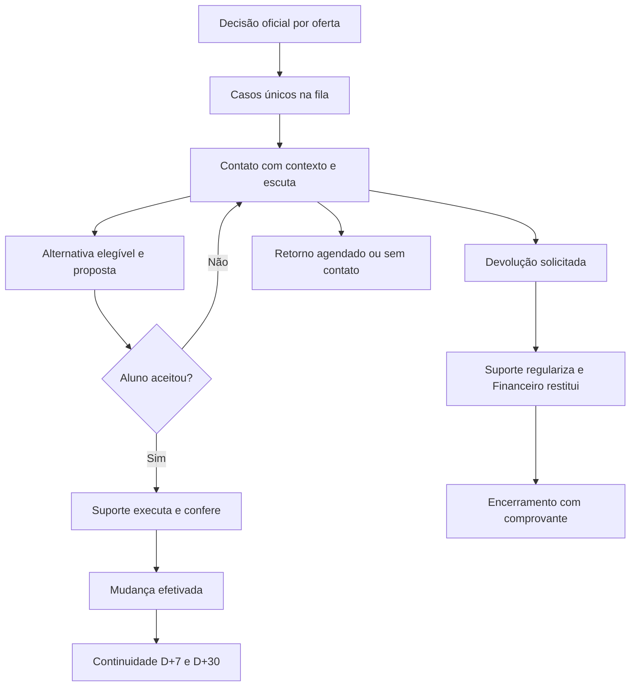

# Processo e estados

## Antes da decisão

Importar um snapshot validado → separar pendências → atualizar projeções → revisar economia → identificar alunos potencialmente afetados → recuperar preferências → preparar comunicação e destinos. O aluno ainda não é comunicado como pertencente a uma turma cancelada.

Cada oferta tem estados de decisão `pending`, `confirmed`, `not_formed`, `strategic_confirmed`, `suspended`. O risco analítico (`low`, `attention`, `high`, `insufficient_data`) é outro campo. Verde no radar não libera proposta. `strategic_confirmed` exige termo de autorização, orçamento e responsável.

Diretoria registra decisão com oferta exata, data, vigência, justificativa e ata/referência. A ação mostra alunos afetados, destinos existentes, mensagens e tarefas que serão criadas. Confirmação em duas etapas na interface; gravação única com identificador de comando. Decisões em lote têm prévia e relatório de erros.

## Depois da decisão

## Estado do caso e estado das tarefas

Não representar tudo com um único `status`. Caso tem etapa comercial; proposta, ajuste e devolução têm ciclos próprios. Uma devolução pode estar em análise enquanto a regularização acadêmica é concluída.

| Caso | Entrada | Saída/condição |
|---|---|---|
| `preparation` | Oferta pendente em monitoramento | Decisão oficial ou descarte do preparo |
| `ready` | Não formação oficial e aluno elegível | Consultor retira caso |
| `in_contact` | Posse válida, primeira abordagem registrada | Proposta, retorno ou restituição |
| `scheduled` | Horário e canal acordados | Vencimento recoloca tarefa para o responsável |
| `proposal` | Proposta versionada enviada de forma simulada | Aceite, recusa, expiração |
| `awaiting_execution` | Aceite registrado e aprovações satisfeitas | Ajuste confirmado ou devolvido para correção |
| `converted` | Ajuste conferido no Lyceum simulado | Acompanhamento de continuidade |
| `refund` | Pedido de saída/restituição | Regularização + desfecho financeiro |
| `unreachable` | Cadência esgotada e revisão da gestão | Reabertura por novo contato |
| `closed` | Desfecho e pendências resolvidos | Reabertura justificada e auditada |

Cada mudança registra ator, origem, horário, versão anterior, motivo e vínculo ao evento. Não apagar negociação anterior ao refazer proposta.

## Passagem Captação → Suporte

Pacote obrigatório: aluno/caso, oferta de origem/destino, modalidade/unidade/turno/agenda, valores antes/depois, parcelas e validade da concessão, crédito do valor já pago, documento/registro de aceite, aprovação quando necessária e checklist de cobranças/documentos.

Suporte aceita a tarefa; confere ficha; simula ajustes; registra protocolo de execução; confere curso, turno, bolsa, cobrança e créditos; devolve inconsistência com motivo; conclui somente após checklist. No MVP usar “Confirmar ajuste simulado no Lyceum”. Não escrever “Integrado” ou “Atualizado no Lyceum” sem essa indicação.

Captação continua responsável pela comunicação; Suporte é responsável pela execução. Não criar dois donos comerciais para o mesmo caso. Concluir execução gera evento e aviso interno simulado ao consultor.

## Recusa e devolução

“Quero meu dinheiro de volta” abre a restituição imediatamente. Não exigir tentativa de retenção, contato telefônico ou resposta a pesquisa. Reembolso e regularização acadêmica são rastreados até o fim, com proprietário e prazo estimado configurado.

Pedido sem pagamento gera regularização sem devolução monetária. Pagamentos múltiplos, créditos parciais e devoluções prévias exigem conciliação. Não estornar dinheiro apenas por abrir o caso.

## Exceções obrigatórias

| Situação | Resposta do sistema |
|---|---|
| Origem confirmada depois de preparar campanha | Pausar comunicações de alternativa; cancelar tarefas preparatórias; manter histórico |
| Destino perde confirmação ou é suspenso | Congelar novas propostas; revisar as abertas e reservas; avisar gestão e consultores |
| Última vaga disputada | Reserva simulada por proposta, com expiração; aceite revalida capacidade |
| Aluno muda de ideia depois do aceite | Cancelar versão vigente, liberar reserva e reabrir caso com motivo |
| Proposta expira | Impedir aceite; recriar somente após revalidação |
| Oferta inexistente ou dado divergente | Caso em pendência, fora da liberação automática |
| Reimportação do mesmo aluno | Atualizar campos de origem sem duplicar caso/evento/proposta |
| Duas matrículas do mesmo aluno | Preservar vínculos; gestão revisa conflito antes de acionar |
| Consultor ausente | Gestão transfere com histórico e justificativa |
| Sem alternativas adequadas | Oferecer esclarecimento e saída; não forçar migração |
| Chamado já aberto no Suporte | Vincular e bloquear solicitação duplicada |

## Depois do pico

Campanha passa a `closing` quando não há casos comerciais abertos; encerramento final exige tarefas acadêmicas/financeiras resolvidas ou exceções formalmente assumidas com responsável. Congelar denominadores e snapshot dos indicadores. D+7 e D+30 são contados a partir do início da oferta de destino, não do aceite.

Tela de baixa temporada mostra resumo, pendências residuais, conhecimento a revisar e preparação da próxima entrada. Nova campanha copia políticas e catálogo revisados, nunca alunos e contatos do ano anterior automaticamente. Reabertura preserva o snapshot de encerramento e cria nova versão do resultado.
