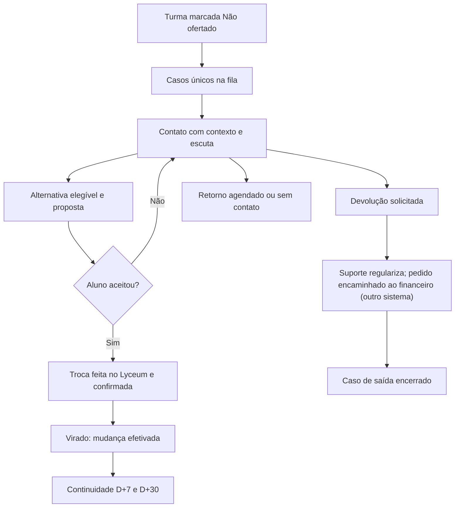

# Processo e estados

## Antes do cadastro Não ofertado

Importar um snapshot validado → separar pendências → atualizar projeções → revisar economia → identificar alunos potencialmente afetados → recuperar preferências → preparar comunicação e destinos. O aluno ainda não é comunicado como pertencente a uma turma cancelada.

Revisão de 12/11/2026: cada turma (curso + modalidade + turno) tem um único cadastro, **Ofertado: Sim ou Não** (`decision.outcome = 'confirmed' | 'not_formed'`). Toda turma começa Ofertada. Não existem estados pendente, estratégico ou suspenso, nem justificativa, ata ou parecer. O risco analítico (`low`, `attention`, `high`, `insufficient_data`) é outro campo e não muda o cadastro. O risco não muda o cadastro: uma turma em risco alto continua ofertada, e destino possível, até a Diretoria/Gestão marcar Não.

Só a Diretoria/Gestão altera o cadastro (`recordDecision`), pelo `OfferSwitch` no painel, no pop-up do catálogo ou no detalhe da turma. Com campanha encerrada, o cadastro fica bloqueado.

| Mudança | Efeito |
|---|---|
| Ofertado → Não ofertado | Antes de salvar, mostra quantos alunos entram na fila e quantas propostas serão congeladas (`previewDecision`). Os matriculados em monitoramento vão para a fila geral (`ready`, sem responsável). Propostas abertas que tinham a turma como destino são congeladas e a vaga reservada é liberada. Consultores são avisados |
| Não ofertado → Ofertado | Casos ativos da turma saem da fila com desfecho "oferta de origem confirmada"; propostas abertas desses alunos são canceladas |
| Ofertado de novo → Não ofertado | Os casos liberados voltam à fila geral sem responsável e sem tentativas anteriores |

Sem impacto (nenhum aluno ou proposta), o clique grava na hora. Toda mudança fica no histórico da turma e na auditoria.

## Depois do cadastro Não ofertado

## Estado do caso e estado das tarefas

Não representar tudo com um único `status`. Caso tem etapa comercial; proposta, ajuste e devolução têm ciclos próprios. O pedido de devolução fica "Encaminhada ao financeiro" enquanto a regularização acadêmica é concluída.

| Caso | Entrada | Saída/condição |
|---|---|---|
| `preparation` | Matrícula em turma ofertada, em monitoramento | Turma marcada Não ofertado |
| `ready` | Turma marcada Não ofertado (aguardando primeiro contato) | Consultor retira caso |
| `in_contact` | Posse válida, primeira abordagem registrada | Proposta, retorno ou restituição |
| `scheduled` | Horário e canal acordados | Vencimento recoloca tarefa para o responsável |
| `proposal` | Proposta versionada enviada de forma simulada | Aceite, recusa, expiração |
| `awaiting_execution` | Aceite registrado e aprovações satisfeitas | Troca confirmada (consultor, Diretoria/Gestão ou Suporte) ou ajuste devolvido para correção |
| `converted` | Troca para outra turma ofertada confirmada no Lyceum simulado ("virado") | Acompanhamento de continuidade |
| `refund` | Pedido de saída/restituição | Suporte conclui a regularização; o caso encerra |
| `unreachable` | Cadência esgotada e revisão da gestão | Reabertura por novo contato |
| `closed` | Desfecho e pendências resolvidos, ou turma voltou a ser ofertada (`origin_confirmed`) | Reabertura justificada e auditada |

Cada mudança registra ator, origem, horário, versão anterior, motivo e vínculo ao evento. Não apagar negociação anterior ao refazer proposta.

## Passagem Captação → Suporte

Pacote obrigatório: aluno/caso, oferta de origem/destino, modalidade/unidade/turno/agenda, valores antes/depois, parcelas e validade da concessão, crédito do valor já pago, documento/registro de aceite, aprovação quando necessária e checklist de cobranças/documentos.

Suporte aceita a tarefa; confere ficha; simula ajustes; registra protocolo de execução; confere curso, turno, bolsa, cobrança e créditos; devolve inconsistência com motivo; conclui somente após checklist. No MVP usar “Confirmar ajuste simulado no Lyceum”. Não escrever “Integrado” ou “Atualizado no Lyceum” sem essa indicação.

Captação continua responsável pela comunicação; Suporte é responsável pela execução. Não criar dois donos comerciais para o mesmo caso. Concluir execução gera evento e aviso interno simulado ao consultor.

Desde 12/11/2026, o consultor responsável ou a Diretoria/Gestão também podem registrar que a troca já foi feita no Lyceum, pelo botão **Confirmar troca realizada no Lyceum** no atendimento e na proposta (`confirmTransfer`). O comando marca o checklist e conclui a tarefa. Não é permitido enquanto o ajuste estiver devolvido pelo Suporte. Só essa confirmação, ou a conclusão pelo Suporte, torna o aluno "virado".

## Recusa e devolução

“Quero meu dinheiro de volta” abre o pedido imediatamente. Não exigir tentativa de retenção, contato telefônico ou resposta a pesquisa. Aqui se registra o pedido ("Encaminhada ao financeiro") e a tarefa de regularização no Suporte; o caso de saída encerra quando o Suporte conclui a regularização. A devolução do dinheiro acontece em outro sistema, onde o financeiro atua.

Pedido sem pagamento gera regularização sem devolução monetária. Pagamentos múltiplos, créditos parciais e devoluções prévias são tratados no sistema de devoluções. Não estornar dinheiro apenas por abrir o caso.

## Exceções obrigatórias

| Situação | Resposta do sistema |
|---|---|
| Origem volta a ser ofertada | Tirar casos ativos da fila (`origin_confirmed`); cancelar propostas abertas; manter histórico |
| Destino marcado Não ofertado | Congelar propostas abertas para ele; liberar reservas; avisar Diretoria/Gestão e consultores |
| Última vaga disputada | Reserva simulada por proposta, com expiração; aceite revalida capacidade |
| Aluno muda de ideia depois do aceite | Cancelar versão vigente, liberar reserva e reabrir caso com motivo |
| Proposta expira | Impedir aceite; recriar somente após revalidação |
| Oferta inexistente ou dado divergente | Caso em pendência, fora da liberação automática |
| Reimportação do mesmo aluno | Atualizar campos de origem sem duplicar caso/evento/proposta |
| Duas matrículas do mesmo aluno | Preservar vínculos; gestão revisa conflito antes de acionar |
| Consultor ausente | Gestão transfere com histórico e justificativa |
| Sem alternativas adequadas | Oferecer esclarecimento e saída; não forçar migração |
| Chamado já aberto no Suporte | Vincular e bloquear solicitação duplicada |

## Depois do pico

Campanha passa a `closing` quando não há casos comerciais abertos; encerramento final exige tarefas acadêmicas resolvidas ou exceções formalmente assumidas com responsável. Congelar denominadores e snapshot dos indicadores. D+7 e D+30 são contados a partir do início da oferta de destino, não do aceite.

Tela de baixa temporada mostra resumo, pendências residuais, conhecimento a revisar e preparação da próxima entrada. Nova campanha copia políticas e catálogo revisados, nunca alunos e contatos do ano anterior automaticamente. Reabertura preserva o snapshot de encerramento e cria nova versão do resultado.
